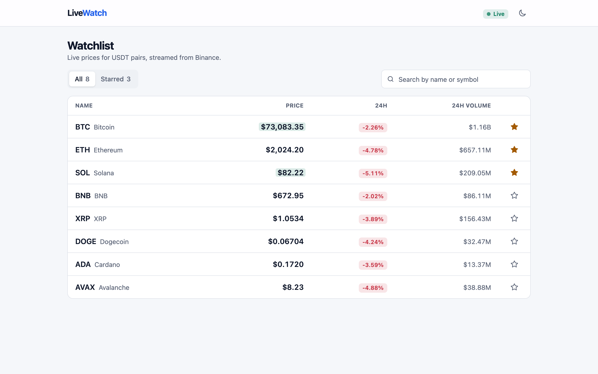
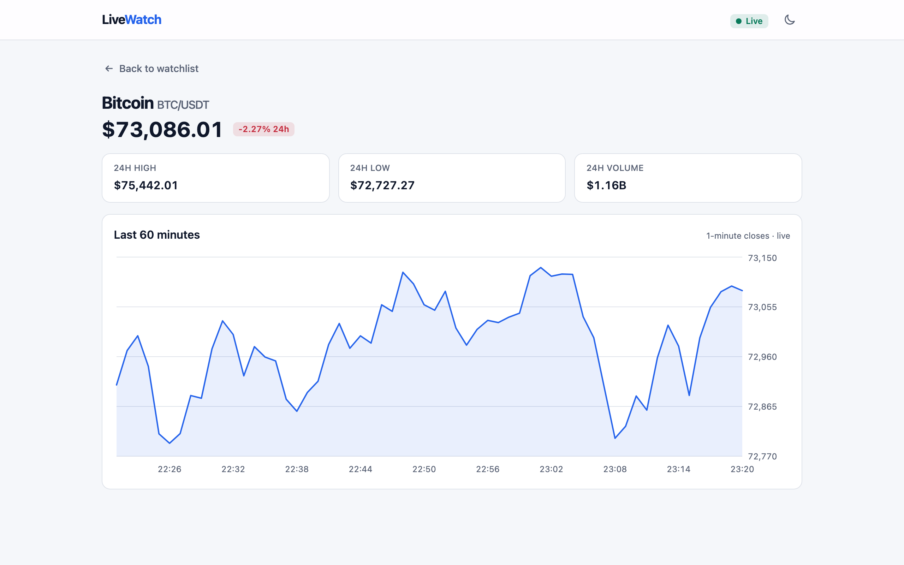
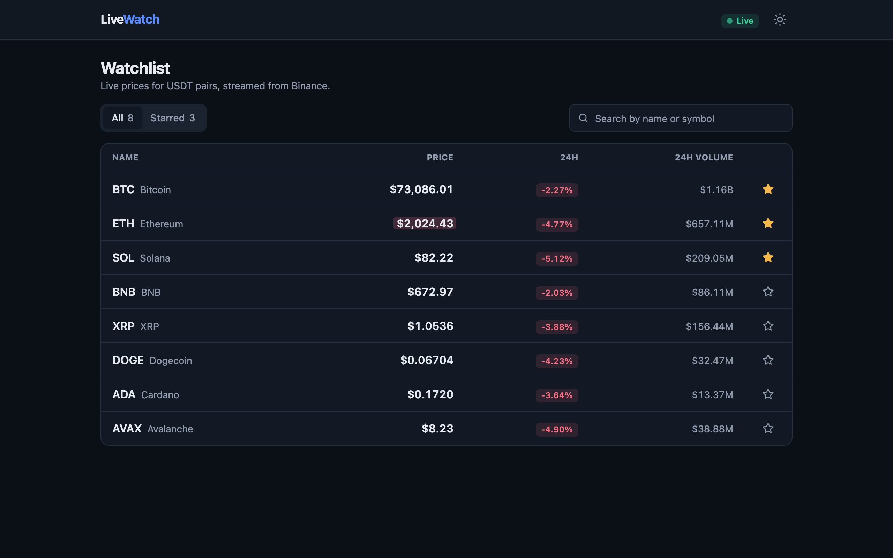
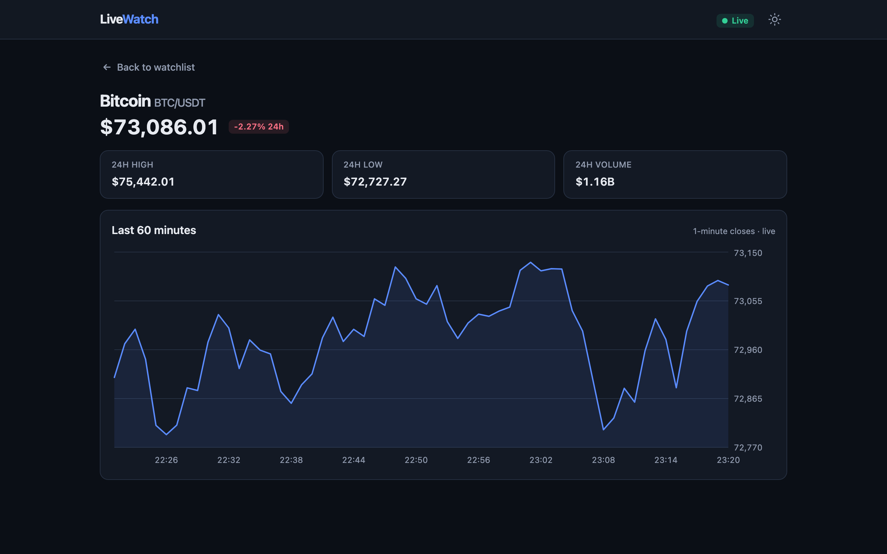
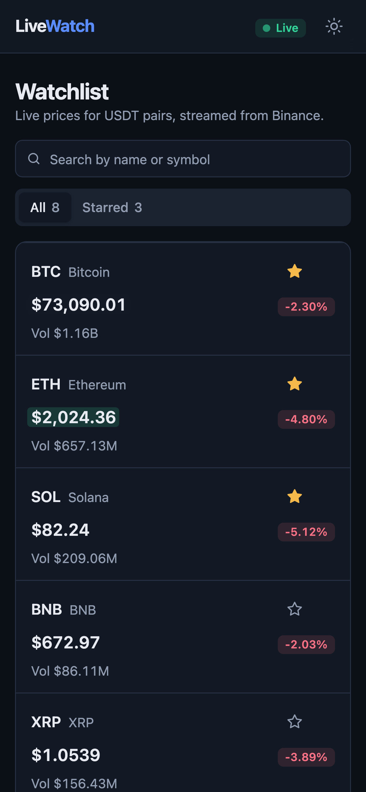
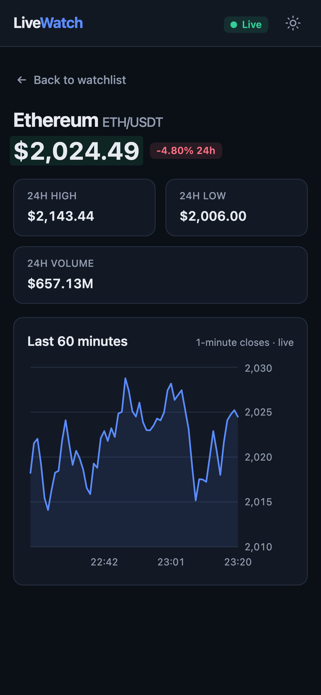

# LiveWatch

A small real-time crypto watchlist. It streams live Binance prices over one WebSocket and stays smooth while dozens of updates arrive every second.

**React 18 · TypeScript (strict) · Vite · Tailwind CSS v4 · Recharts · React Router · Playwright**

## Screenshots

The app isn't deployed, so here is what it looks like running locally against live Binance data. To see it yourself, follow [Running it](#running-it).

| Watchlist | Coin detail |
|---|---|
|  |  |
|  |  |

<p>
  
  &nbsp;
  
</p>

## What it does

- **Watchlist** of 8 USDT pairs (BTC, ETH, SOL, BNB, XRP, DOGE, ADA, AVAX) with live price, 24h change and 24h volume.
  - The price cell flashes green or red on each move.
  - Search by symbol or name.
  - All / Starred tabs. Stars persist in `localStorage`.
- **Coin page** (`/coin/BTCUSDT`) with live price, 24h change, high, low and volume.
  - A 60-minute chart: one-minute closes from the REST API, kept live from the socket. A price in the current minute replaces the last point; a new minute appends one.
- **Connection handling**
  - A Live / Reconnecting / Offline badge.
  - Automatic reconnect with exponential backoff (1s → 2s → 4s … max 30s, plus jitter).
  - A "Can't reach market data. Retrying…" banner while disconnected.
- **Every state handled**
  - Loading: skeleton rows, and a chart placeholder.
  - Errors: the reconnect banner, and a price-history error with Retry.
  - Stale data: a row greys out after 10s without an update.
  - Empty: "No coins match your search" and "Star a coin to see it here".
- **Shared UI kit** in `components/ui/`: Button, Badge, Card, Skeleton, EmptyState and StatusBadge.
- **Light and dark themes** built on CSS-variable tokens.
- **Responsive.** A table on desktop, stacked cards at 375px, with no horizontal scroll.

Data comes from Binance's public market-data endpoints, which need no API key.

## Running it

Requires Node 20+.

```bash
npm install
npm run dev        # http://localhost:5173
```

| Command | What it does |
|---|---|
| `npm run dev` | Dev server. Includes the perf overlay (bottom-left). |
| `npm run build` | Type-check (`tsc -b`) and production build to `dist/` |
| `npm run preview` | Serve the production build |
| `npm run lint` | ESLint with type-aware TypeScript rules, React Hooks rules and `no-explicit-any` |
| `npm run test:e2e` | Playwright end-to-end tests |
| `npm run perf` | Live performance measurement (see [Performance](#performance)) |

## Tests

```bash
npx playwright install chromium   # first time only
npm run test:e2e
```

The tests build the app and run against the **production build** (`vite preview`). They never touch live data:

- **WebSocket:** `page.routeWebSocket()` intercepts the Binance stream and never calls `connectToServer()`, so the test acts as the server. It sends ticker and trade frames and can drop the connection.
- **REST:** `page.route()` answers the klines request with generated data.
- **Safety net:** a lower-priority `page.route(/binance\.vision/)` aborts any request that isn't mocked.
- **Setup:** all of this lives in one auto-fixture (`e2e/fixtures.ts`), so every test is isolated by default.

| Test | Checks |
|---|---|
| a | Skeleton rows until the first frame, then prices. A trade updates the price and flashes it green. |
| b | Search by symbol and by name, the empty state, and "Clear search" |
| c | Starring a coin shows it under Starred, and it survives a reload |
| d | A row click opens the coin page with live stats and the chart; Back returns to the list |
| e | A server-side socket close shows the reconnecting banner, then the app reconnects and goes back to Live |
| f | No horizontal overflow at 375px on the watchlist and the coin page |
| extra | A failed price-history request shows the error state, and Retry recovers |

## Performance

### The problem

The `@aggTrade` stream sends a message for every trade. Across 8 coins that averaged **~41 messages/s, peaking near 200/s**. Writing each one into React state would re-render the list dozens of times a second, far faster than anyone can read a number.

### What the app does

1. **One shared socket.** `services/marketSocket.ts` owns a single combined-stream connection. It opens for the first subscriber and closes, with all its timers, when the last one leaves. It subscribes once at the app root, so moving between pages never reconnects.
2. **Buffer, then flush every 200ms.** `hooks/useTickers.ts` writes incoming messages into a `useRef` buffer, which never causes a render. Each coin collapses to its latest values. At most every 200ms the buffer is applied with **one** `setState`.
3. **Stable references and `React.memo`.**
   - The flush only creates a new object for a coin whose visible data changed. Unchanged coins keep the same object, and if nothing changed at all the previous state object is returned, so React skips the render entirely.
   - Rows are `React.memo`. Their callbacks come from `useCallback`, with functional `setState` so the dependency list stays empty.
   - Result: a BTC tick re-renders the BTC row only.
4. **No render cost for the flash.** The price `<span>` is keyed by the price. A new price remounts the span, which replays a 400ms CSS animation. There are no timers or extra state, and no second render to clear a class.
5. **Smaller supporting choices**
   - Tabular numerals, so digits don't jitter.
   - The chart's animation is disabled, so it doesn't restart on every update.
   - Connection status reads through `useSyncExternalStore`, kept outside the tickers context, so the header re-renders only when the status changes.
   - The chart library is lazy-loaded with the coin page (the watchlist bundle is ~75 kB gzipped).

### Measured results

Live Binance data in a production build, Apple M2 with headless Chromium 158, on 2026-11-10. There were two runs of 60 seconds each; the table shows their average.

| Mode | Socket msgs/s | List renders/s | Row renders/s | Main-thread busy (ms per s) |
|---|---|---|---|---|
| **Batching + memo (shipped)** | 41.2 | **3.9** | **11.2** | **10.6** |
| No batching, memo | 41.2 | 18.9 | 19.8 | 17.4 |
| Batching, no memo | 41.2 | 3.9 | 31.2 | 11.2 |
| No batching, no memo | 41.2 | 18.9 | 151.2 | 18.8 |

- **Batching:** list renders fell from 18.9/s to 3.9/s (**−79%**).
- **Batching + memo together:** row renders fell from 151/s to 11/s (**−93%**), and main-thread time fell from 18.8 to 10.6 ms/s (**−44%**).
- **Memo alone**, with batching already on: row renders fell from 31/s to 11/s (**−64%**).

Two honest notes:

- **Without batching, React rendered ~19 times/s, not 41.** Two things soak up the rest. React 18's automatic batching merges messages that arrive in the same burst. And `applyUpdates` returns the previous state when a trade doesn't change the price, so React bails out.
- **Memo's main-thread saving is small here** (11.2 → 10.6 ms/s), because 8 rows are cheap to render. Its value shows in the render count and grows with the size of the list.

### How it was measured

- **Counters.** `src/dev/perf.ts` counts socket messages, list renders and row renders. Renders are counted in a `useEffect`, so they are committed renders only: memo-skipped renders aren't counted, and StrictMode's double render isn't counted twice.
- **Switches.** `?batch=0` turns off the buffer (one `setState` per message). `?memo=0` makes `memo` always re-render. Both are dev/perf-build only; a normal production build compiles them out.
- **Runner.** `npm run perf` builds with `VITE_PERF=true` and runs `scripts/measure-perf.mjs`, which:
  - opens **all four modes at once**, in separate browser contexts, so they see the same live market;
  - waits 5s, then samples per-second counts for 60s (`PERF_SECONDS` to change);
  - reads main-thread busy time from the Chrome DevTools Protocol (`Performance.getMetrics` → `TaskDuration`).
- **In development,** `npm run dev` shows the same numbers live in the bottom-left overlay. Try `http://localhost:5173/?batch=0&memo=0`.

Message rates depend on market activity, so expect different absolute numbers on another day. The ratios between modes are what matter.

## Project structure

```
src/
  config.ts              endpoints, coins, intervals, storage keys
  types.ts               domain types (Ticker, MarketEvent, ConnectionStatus…)
  services/marketSocket.ts   the one WebSocket: subscribe/unsubscribe, status, backoff, message validation
  hooks/
    useTickers.ts        ref buffer + 200ms flush, stable references, staleness clock
    useKlines.ts         REST history with abort, retry, and live-price merge
    useStarred.ts        localStorage-backed stars (guarded with try/catch)
    useConnectionStatus.ts / useTheme.ts
  context/               MarketDataProvider: one subscription shared by every page
  components/
    ui/                  Button, Badge, Card, Skeleton, EmptyState, StatusBadge
    watchlist/           WatchlistTable, WatchlistRow (memo), SearchBar, Tabs
    layout/              AppLayout, ConnectionBanner, ThemeToggle
    coin/PriceChart.tsx
  pages/                 WatchlistPage, CoinPage (lazy-loaded), RouteError
  dev/                   perf counters + overlay (excluded from normal production builds)
e2e/                     Playwright specs + socket/REST mock fixtures
scripts/measure-perf.mjs live performance measurement
```

## Notes and trade-offs

- **Prices come from `@aggTrade`; 24h stats from `@ticker`.** A coin first appears when its first ticker frame arrives (≤1s), because that frame carries every field. A row is never half-filled.
- **Stale detection runs on a 1s clock, not on messages.** When the socket is down no messages arrive, so nothing else would trigger the render that greys the rows out.
- **"Offline" uses the browser's `online`/`offline` events.** Retrying with no network is pointless, so the app waits for `online` and then reconnects immediately.
- **Socket data is untrusted.** Every frame is validated field by field (no `any`, no casts). Malformed frames are dropped.
